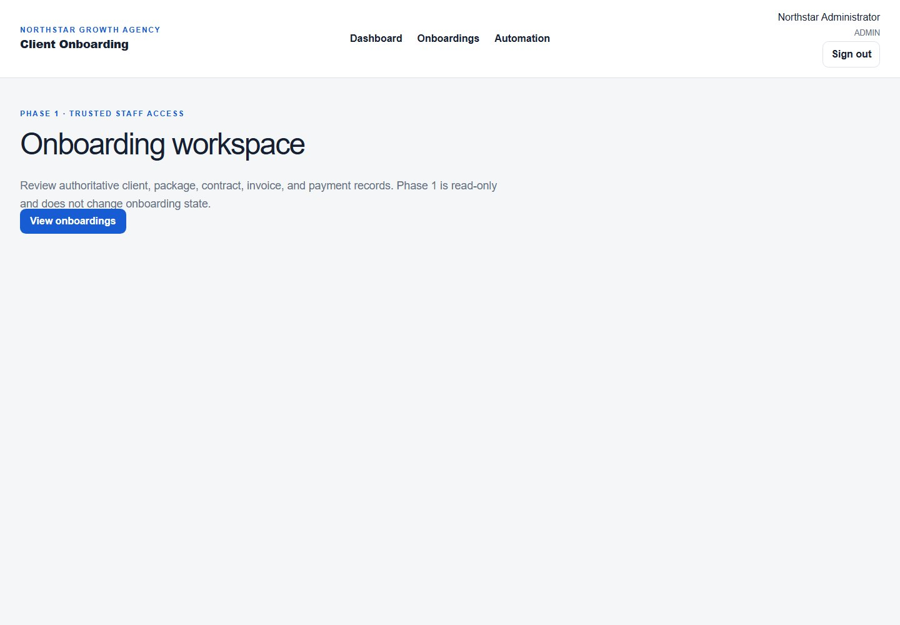
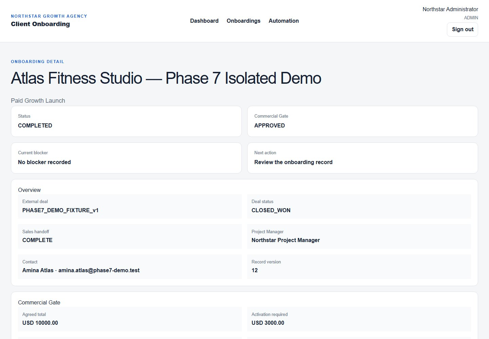
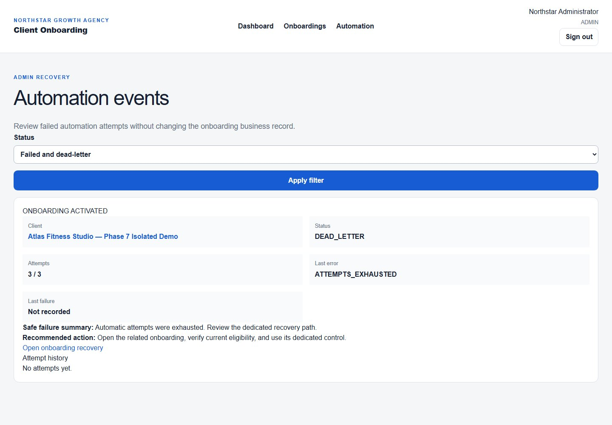
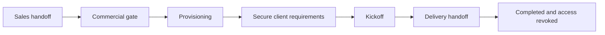
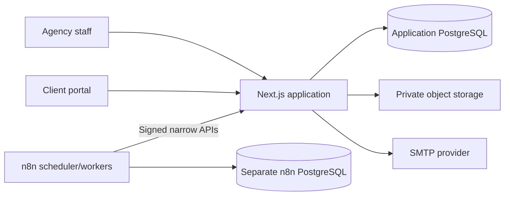

# Client Onboarding Platform

[](https://github.com/waliidtlm/client-onboarding-platform/actions/workflows/ci.yml)

A production-minded workflow platform for service agencies that need to move a client from signed
deal to delivery without losing ownership, evidence, or follow-up across spreadsheets and chat.

The platform brings commercial approval, provisioning, secure client requirements, kickoff,
Delivery handoff, reminders, recovery, and audit history into one controlled onboarding record.

> Portfolio scope: all people, companies, email addresses, messages, and files are fictional. The
> local n8n, Mailpit, MinIO, and provisioning adapter demonstrate integration boundaries; they are
> not presented as production services.

## Product tour

### One workspace for ownership, blockers, and next actions



| Completed onboarding record                                                                              | Auditable automation recovery                                                                          |
| -------------------------------------------------------------------------------------------------------- | ------------------------------------------------------------------------------------------------------ |
|  |  |

The screenshots are generated from an isolated, deterministic fixture. Capture rejects visible
credentials, bearer fragments, hashes, and local paths before the images are committed.

## What the workflow covers



- Sales can submit an incomplete handoff and correct the same onboarding record.
- Operations and Finance control contract, invoice, payment, and activation decisions.
- Provisioning work is durable, retryable, and subject to Project Manager approval.
- Clients receive short-lived secure access for versioned requirement submissions and files.
- Kickoff and Delivery handoff use frozen, revisioned records with explicit ownership.
- Bounded reminders escalate stalled work without creating unlimited client notifications.
- Administrators can inspect safe failure summaries and authorize eligible recovery paths.

## Why this is more than a CRUD demo

| Engineering concern    | Implementation evidence                                                                                                                                               |
| ---------------------- | --------------------------------------------------------------------------------------------------------------------------------------------------------------------- |
| Business integrity     | PostgreSQL transactions, immutable snapshots, append-only audit records, and explicit state transitions                                                               |
| Automation reliability | Transactional outbox events, leases, idempotency keys, bounded retries, dead-letter handling, and recovery controls                                                   |
| Security               | Argon2id passwords, role-based query boundaries, hashed capability tokens, HMAC-authenticated worker APIs, CSRF/origin checks, rate limits, and environment-aware CSP |
| Data isolation         | Separate application, test, migration, shadow, and n8n databases with non-superuser roles                                                                             |
| Verification           | Unit, PostgreSQL integration, Playwright, migration, workflow-export, documentation, secret, dependency, and production-build checks in CI                            |
| Honest boundaries      | Local adapters are labeled as demonstrations and production requirements are documented separately                                                                    |

## Architecture



The application—not n8n—owns business decisions, authorization, policy evaluation, recipient
selection, and terminal state. n8n receives identifiers, schedules work, and calls narrow signed
APIs without application-database credentials.

See [Architecture and data model](docs/architecture.md) for the entity model, trust boundaries,
and reminder sequence.

## Technology

- Next.js 16, React 19, TypeScript, Auth.js, and Zod
- PostgreSQL 18, Prisma 7, and isolated database roles
- n8n for orchestration through application-owned APIs
- MinIO-compatible private object storage and SMTP delivery boundaries
- Vitest, Playwright, Secretlint, Prettier, ESLint, Docker, and GitHub Actions
- pnpm workspace monorepo

## Verification evidence

The required pull-request workflow validates:

1. frozen dependency installation and Prisma schema validity;
2. formatting, ESLint, and strict TypeScript;
3. unit and Route Handler tests;
4. PostgreSQL integration tests and the applied migration chain;
5. Chromium installation and Playwright application tests;
6. n8n exports and documentation links;
7. the production build, current-tree and full-history secret scans, screenshot redaction and
   metadata validation, production dependency audit, and clean diff.

The accepted Phase 7 portfolio gate includes 180 unit/route tests, 52 PostgreSQL integration
tests, and 17 Playwright scenarios. The isolated demo adds Mailpit, MinIO, n8n, lifecycle, retry,
recovery, reminder, revocation, screenshot, and redaction evidence.

## Run the isolated portfolio demo

Prerequisites:

- Node.js 24.16 or newer in the Node 24 line
- pnpm 11.9
- Docker with Compose

Install dependencies and the browser once:

```powershell
pnpm.cmd install --frozen-lockfile
pnpm.cmd --filter @client-onboarding/web exec playwright install chromium
```

Run the isolated end-to-end scenario:

```powershell
pnpm.cmd demo:phase7
```

The demo uses its own Compose project, databases, volumes, loopback ports, fictional `.test`
recipients, and exact fixture marker. It verifies the lifecycle through `COMPLETED`, then refreshes
the redaction-checked screenshots.

Clean only demo-owned resources:

```powershell
pnpm.cmd demo:phase7:cleanup
```

Run the complete portfolio verification gate:

```powershell
pnpm.cmd verify:final
```

See the [portfolio demo guide](docs/demo-script.md) for the evaluator walkthrough and expected
evidence. For regular development, use the [technical reference](docs/technical-reference.md).

## Documentation map

| Document                                            | Purpose                                                                   |
| --------------------------------------------------- | ------------------------------------------------------------------------- |
| [Architecture and data model](docs/architecture.md) | Runtime ownership, trust boundaries, entities, and reminder flow          |
| [Portfolio demo guide](docs/demo-script.md)         | Automated scenario, evaluator walkthrough, evidence, and cleanup          |
| [Technical reference](docs/technical-reference.md)  | Local development, commands, accounts, endpoints, and database isolation  |
| [Security hardening](docs/security-hardening.md)    | Dependency remediation, CI controls, and deployment security requirements |
| [Deployment guide](docs/deployment.md)              | Local stack boundary and production requirements                          |
| [Known limitations](docs/known-limitations.md)      | Deliberate portfolio limits and remaining production work                 |

## Repository layout

```text
apps/web/                  Next.js application, Prisma schema, tests, and demo tooling
automation/n8n/            Inactive, validated workflow exports
docker/postgres/init/      Isolated PostgreSQL role/database bootstrap
docs/                      Architecture, demo, security, deployment, and screenshots
scripts/                   Repository verification and isolated demo orchestration
```

## Publishing safely

Do not ZIP or upload the working directory. Ignored `.env*` files and generated `.next` output can
contain local credentials. Create a public archive from tracked Git content only:

```bash
git archive --format=zip --output=../client-onboarding-platform-public.zip HEAD
```

Before publishing, run `pnpm secret:scan`, `pnpm history:scan`, and `pnpm screenshots:scan`.

## Status and limitations

This is a complete local portfolio implementation through the accepted Phase 7 scope. It is not
a hosted SaaS product or a production deployment template. Production adoption still requires
managed services, SSO/MFA, malware scanning, TLS, secrets management, backups, monitoring,
retention policy, and reviewed infrastructure controls.

Read [Known limitations](docs/known-limitations.md) before evaluating production use.
