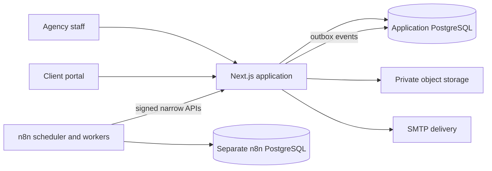
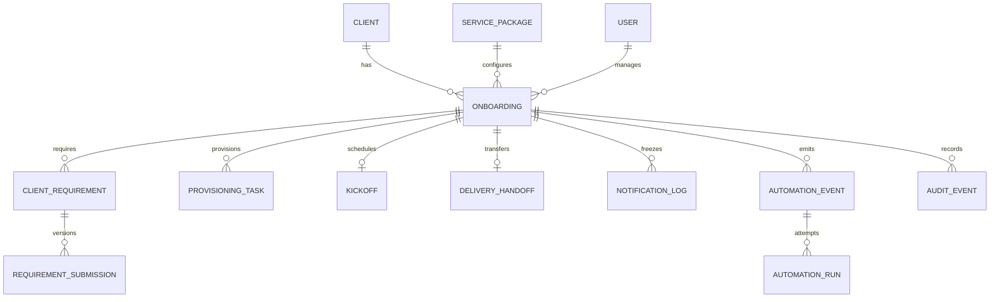
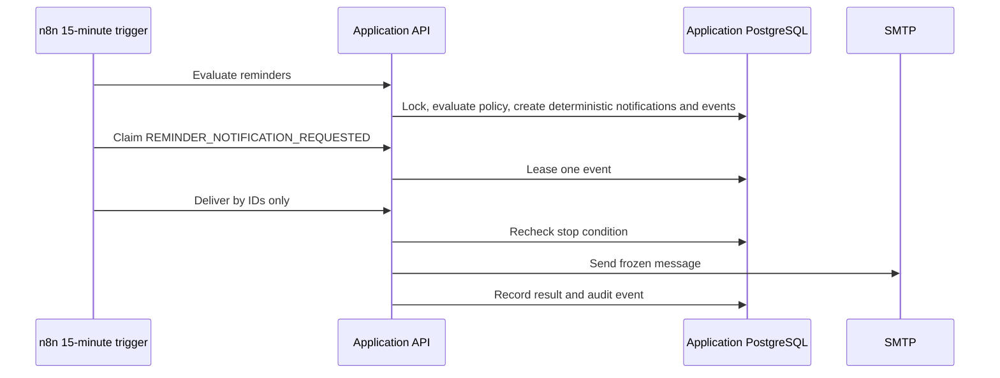

# Architecture and data model

## Runtime boundary

The application owns state transitions, reminder policy, recipient selection, idempotency, and
delivery eligibility. n8n schedules evaluation, claims durable events, and calls narrow
application endpoints. It has no application-database credentials.

## Core entities

Sensitive client tokens are stored as hashes plus reconstruction components. Audit presentation
selects safe fields; it does not expose stored before/after JSON to Delivery users.

## Phase 7 reminder loop

